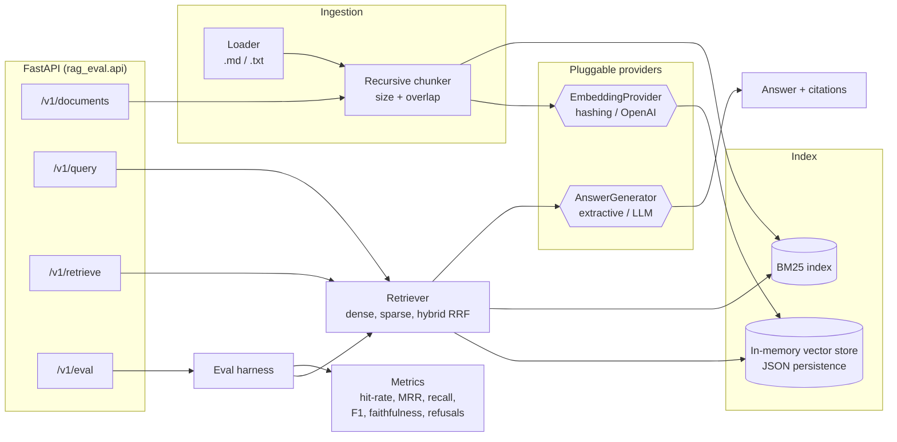

# rag-eval-service

[](https://github.com/hakimdev86-eng/rag-eval-service/actions/workflows/ci.yml)


A compact **retrieval-augmented generation (RAG) service** built with FastAPI, plus an
**evaluation harness** that measures retrieval and answer quality and can **fail CI when quality
regresses**.

The pipeline goes ingest → chunk → embed → hybrid retrieval (BM25 + dense, fused with RRF) →
grounded generation with citations. All of it runs **offline by default**: a deterministic
hashing embedder and an extractive answer generator mean the tests, the CI and the demo need no
API keys. Point two environment variables at OpenAI (or any OpenAI-compatible endpoint such as
Ollama or vLLM) to use real models.

> This repo is a deliberately small showcase. It focuses on clean seams between components and on
> measuring quality, not on covering every vector database.

## Architecture



## Features

- **Ingestion**: markdown/text loader and a recursive, separator-aware chunker (paragraph → line → sentence → word) with word-boundary overlap. Re-ingesting a document id replaces it.
- **Retrieval**: `dense`, `sparse` (Okapi BM25) or `hybrid` mode. Hybrid uses Reciprocal Rank Fusion, so it doesn't depend on score scales.
- **Grounded generation**: the prompt numbers every source and requires `[n]` citations. The API maps citations back to chunk ids and drops any it can't verify (for example, out-of-range numbers).
- **Offline by default**: `HashingEmbeddings` (signed feature hashing over unigrams and bigrams) and `ExtractiveAnswerGenerator` (IDF-weighted sentence selection that refuses when the evidence is weak).
- **Real providers**: an OpenAI-compatible embeddings and chat client built on `httpx`, tested against `httpx.MockTransport`.
- **Evaluation harness**:
  - Retrieval: hit-rate@k, recall@k, MRR
  - Answers: token F1 against reference answers
  - **Faithfulness**: the share of answer sentences supported by the retrieved context. A fast lexical version runs in CI, and an optional **LLM-as-judge** version falls back safely when the judge returns malformed output.
  - Refusal accuracy on unanswerable questions, and the false-refusal rate on answerable ones
  - p50/p95 latency
- **Quality gate**: `rag-eval --min-hit-rate 0.9 --min-faithfulness 0.9` exits non-zero on regression and is wired into CI, which also posts a markdown report to the job summary.
- **Engineering**: strict `mypy`, `ruff`, 62 tests at about 96% branch coverage, a multi-stage non-root Docker image with a healthcheck, and docker-compose.

## Quickstart

```bash
python -m venv .venv && source .venv/bin/activate
pip install -e ".[dev]"

pytest                       # 62 tests, fully offline
rag-eval                     # evaluate on the bundled dataset
uvicorn rag_eval.main:app    # http://localhost:8000/docs
```

With Docker:

```bash
cp .env.example .env
docker compose up --build          # API on :8000
docker compose run --rm eval       # one-off quality-gate run
```

To use OpenAI (or Ollama with `RAG_OPENAI_BASE_URL=http://localhost:11434/v1`):

```bash
export RAG_EMBEDDING_PROVIDER=openai RAG_LLM_PROVIDER=openai RAG_OPENAI_API_KEY=sk-...
```

## API examples

```bash
# Ask a question (hybrid retrieval, top 4 by default)
curl -s localhost:8000/v1/query -H 'content-type: application/json' \
  -d '{"question": "How long are audit logs retained?"}'
```

```json
{
  "question": "How long are audit logs retained?",
  "answer": "Audit logs are retained for 400 days and can be exported to customer-owned storage. [1]",
  "citations": [
    {"source": 1, "chunk_id": "data-retention::1", "doc_id": "data-retention", "score": 0.0328, "snippet": "..."}
  ],
  "retrieval_mode": "hybrid",
  "latency_ms": 1.1
}
```

```bash
# Ingest your own documents
curl -s localhost:8000/v1/documents -H 'content-type: application/json' \
  -d '{"documents": [{"id": "travel-policy", "text": "Employees fly economy on flights under six hours."}]}'
# -> {"documents": 1, "chunks": 1}

# Inspect retrieval only, comparing modes
curl -s localhost:8000/v1/retrieve -H 'content-type: application/json' \
  -d '{"question": "HTTP 429", "top_k": 2, "mode": "sparse"}'

# Run the evaluation over the bundled dataset
curl -s localhost:8000/v1/eval -H 'content-type: application/json' -d '{"top_k": 3}'

# Manage documents
curl -s localhost:8000/v1/documents
curl -s -X DELETE localhost:8000/v1/documents/travel-policy
```

| Method | Path | Purpose |
|---|---|---|
| GET | `/health` | Status, index size, active providers |
| POST | `/v1/documents` | Ingest or replace documents |
| GET | `/v1/documents` | List documents and their chunk counts |
| DELETE | `/v1/documents/{id}` | Remove a document |
| POST | `/v1/retrieve` | Ranked chunks only |
| POST | `/v1/query` | Answer with citations |
| POST | `/v1/eval` | Run the evaluation harness |

## Evaluation

The bundled dataset (`data/`) is a fictional cloud provider's handbook: 6 documents and 18
questions. Two of the questions can't be answered from the documents, which tests refusals.
Baseline with the offline providers:

| Metric | Value (k=4, hybrid) |
|---|---|
| Hit rate@k / Recall@k / MRR | 1.000 / 1.000 / 1.000 |
| Answer token F1 | 0.731 |
| Faithfulness | 1.000 |
| Refusal accuracy (unanswerable) | 1.000 |
| False refusal rate | 0.000 |

These numbers come from a deliberately small, easy corpus, so retrieval saturates. The dataset is
a **regression test**, not a benchmark. To compare chunking, embedding and prompt changes in a
meaningful way, add your own JSONL file (`{"id", "question", "expected_doc_ids", "reference_answer", "answerable"}`)
and run `rag-eval --dataset my.jsonl --corpus my_docs/`.

## Project layout

```
src/rag_eval/
  api/            FastAPI app factory, schemas, dependency injection
  ingestion/      loader + recursive chunker
  embeddings/     EmbeddingProvider protocol, hashing + OpenAI implementations
  retrieval/      vector store, BM25, retriever with RRF
  generation/     prompts, ChatClient protocol (OpenAI + fake), answer generators
  eval/           dataset, metrics, harness, CLI quality gate
  pipeline.py     wires everything together
data/             bundled corpus + evaluation set
tests/            unit, integration and API tests (no network)
```

## Design decisions

- **Protocols instead of frameworks.** Embeddings, chat and answer generation sit behind small `typing.Protocol` interfaces. Production code and test doubles meet the same contract, so tests stay fast and deterministic, and switching provider is a configuration change. LangChain would work here, but owning a 30-line client keeps the request shape visible and easy to test.
- **Hybrid retrieval by default.** BM25 catches exact identifiers ("HTTP 429", "AES-256") that embeddings often miss, and dense vectors catch paraphrases. RRF merges the two without calibrating score scales.
- **Measure before tuning.** Every change to chunking, retrieval or prompts can be checked with `rag-eval`, and CI blocks regressions. The faithfulness metric has two implementations: a cheap lexical one for every commit and an LLM judge for deeper offline runs.
- **Refusing is a feature.** The prompt and the extractive baseline both prefer "I don't know" to an unsupported answer. The harness tracks refusal accuracy and false refusals separately so a change can't game one at the cost of the other.
- **Simple storage, clear seam.** The vector store is in memory with JSON persistence, which is fine for thousands of chunks. The retriever only needs `add`/`search`/`chunks`, so swapping in pgvector or Qdrant is a contained change.
- **Twelve-factor configuration.** Everything is set through `RAG_*` environment variables with validation. For example, the service refuses to start if an OpenAI provider is selected without a key.

## Limitations

- The hashing embedder is lexical, not semantic. It exists so the project runs offline, so use a real embedding model for production.
- The extractive generator is a baseline. It can't synthesise across sentences, and short questions that hinge on a single unseen term can still slip past its refusal heuristic.
- The index lives in a single process. Scaling out needs an external vector store.

## License

[MIT](LICENSE) © 2026 Hakim Rashid
